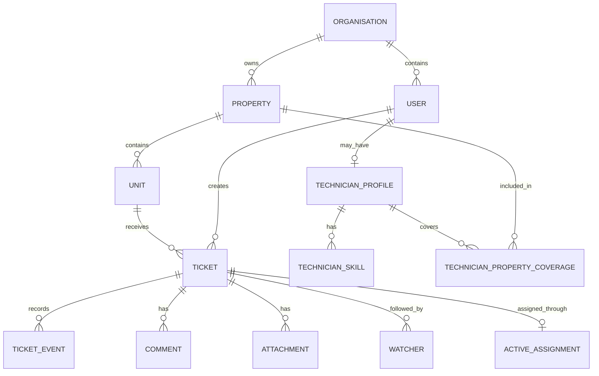

# DeskOps – Technical Design Document

**Project:** DeskOps – Service Desk Platform with an SLA Engine  
**Phase:** Phase 1 – Ticketing Core  
**Document ID:** LV-WD-DESKOPS-P1  
**Version:** 0.2 – Draft for mentor review  
**Prepared by:** [Gopiprakan]  
**Date:** 14 November 2026  
**Status:** Pending mentor review and approval; module ownership and FR-1.08 are unconfirmed

---

## 1. Project Overview

DeskOps is a multi-tenant service desk platform designed to manage maintenance requests for facilities management companies.

Currently, maintenance requests may arrive through WhatsApp, phone calls and email. This makes it difficult to track requests, assignments and overdue work.

The purpose of DeskOps is to provide a centralized platform where residents can raise maintenance tickets and technicians can manage and resolve them. Every important ticket activity will be recorded.

## 2. Project Objectives

- Provide a centralized maintenance ticketing system.
- Allow residents to create and track maintenance requests.
- Allow staff to assign tickets to technicians.
- Maintain ticket status and activity history.
- Support multiple facilities organisations with tenant isolation.
- Provide real-time ticket updates.
- Support email-based ticket creation and attachments.

## 3. Project Scope

### 3.1 Included in Phase 1

- Organisation, property and unit management.
- User authentication and role-based access.
- Ticket creation and management.
- Ticket lifecycle and history.
- Technician assignment.
- Comments and attachments.
- Email-to-ticket integration.
- Real-time updates.
- Duplicate ticket merging (CR-1).
- Client-specific requirement (pending confirmation).

### 3.2 Out of Scope

- Maintenance-fee billing.
- Visitor management.
- Native mobile applications.

## 4. Technology Stack

| Layer | Technology |
|---|---|
| Frontend | React 18, TypeScript, Vite |
| UI styling | Tailwind CSS |
| Data fetching | TanStack Query |
| Forms and validation | React Hook Form, Zod |
| Backend | Node.js 22, TypeScript, Express |
| API documentation | Swagger / OpenAPI |
| Database | PostgreSQL |
| Database ORM | Prisma |
| Cache and queue support | Redis / Upstash |
| Background jobs | BullMQ |
| Real-time communication | Socket.io |
| File storage | Cloudflare R2 or AWS S3 |
| Testing | Vitest, Supertest, Playwright |
| Deployment | Docker, GitHub Actions, Render |
| Logging and monitoring | Pino, Sentry |

## 5. System Architecture

The application will use a frontend-backend architecture.

1. The React frontend provides interfaces for residents and staff.
2. The backend API handles authentication, validation, permissions and business logic.
3. Prisma communicates with the PostgreSQL database.
4. Middleware checks the user's organisation before accessing tenant-specific records.
5. Redis and BullMQ handle background jobs.
6. Socket.io sends ticket updates to other signed-in users.
7. S3-compatible storage handles attachments using presigned upload URLs.

### Request flow

User → React Frontend → Express API → Middleware → Service Layer → Repository Layer → PostgreSQL

Background jobs will be processed separately by BullMQ workers.

## 6. Initial Database Design

The following entities are proposed for the initial database design.

| Entity | Purpose |
|---|---|
| Organisation | Stores facilities company information |
| Property | Stores properties belonging to an organisation |
| Unit | Stores residential or office units |
| User | Stores user account information |
| TechnicianProfile | Stores technician skills and coverage |
| Ticket | Stores maintenance requests |
| TicketEvent | Stores ticket status changes and history |
| Comment | Stores internal and public comments |
| Attachment | Stores uploaded file information |
| Watcher | Stores users following a ticket |
| Assignment | Stores technician assignment information |

**Tenant isolation:** Every database table must carry `organisationId`. Database queries must be scoped through middleware, not by relying on developers to remember manual filtering.

Final relationships, constraints and indexes will be confirmed during implementation.

## 7. Ticket Lifecycle

Tickets must follow the required lifecycle:

`New → Triaged → Assigned → In Progress → On Hold → Resolved → Closed`

The backend will validate every status transition. Illegal transitions will be rejected.

Every transition will create a ticket history event containing:

- Ticket ID
- Previous status
- New status
- Actor
- Timestamp

Reopening will be supported within a configurable time window.

## 8. API Design

All APIs will use the version prefix `/api/v1`.

Proposed endpoints:

| Method | Endpoint | Purpose |
|---|---|---|
| POST | /api/v1/auth/login | User login |
| GET | /api/v1/tickets | List tickets |
| POST | /api/v1/tickets | Create a ticket |
| GET | /api/v1/tickets/:id | Get ticket details |
| PATCH | /api/v1/tickets/:id/status | Change ticket status |
| POST | /api/v1/tickets/:id/assign | Assign a technician |
| GET | /api/v1/tickets/:id/history | View ticket history |
| POST | /api/v1/tickets/:id/comments | Add a comment |
| POST | /api/v1/tickets/:id/attachments | Request an upload URL |

All request inputs will be validated using Zod. APIs will use a consistent error response format, cursor pagination and idempotency keys for create operations.

OpenAPI documentation will be available at `/docs`.

## 9. Roles and Permissions

The following is a proposed initial permission model, subject to mentor review.

| Role | Main permissions |
|---|---|
| Resident | Create tickets, view own tickets, add public comments |
| Technician | View assigned tickets, update permitted statuses, add comments |
| Admin / Staff | Manage tickets, assign technicians, view and manage organisation records |

Internal comments must only be visible to staff. Public comments may be visible to residents.

Access will be enforced by backend authorization checks, not only by hiding frontend controls.

## 10. Functional Requirements Coverage

| Requirement | Design approach |
|---|---|
| FR-1.01 Organisation model | Organisation, property, unit and user entities |
| FR-1.02 Ticket lifecycle | Backend state-machine validation |
| FR-1.03 Ticket history | TicketEvent records |
| FR-1.04 Attachments | Presigned uploads, file checks and thumbnail worker |
| FR-1.05 Email-to-ticket | Inbound email webhook or compatible mock endpoint |
| FR-1.06 Real-time updates | Socket.io |
| FR-1.07 Comments | Internal and public comment visibility |
| FR-1.08 Client-specific rule | Pending mentor confirmation |

## 11. Non-Functional Requirements

- **NFR-01 Tenancy:** Every table has `organisationId`; tenant queries are middleware-scoped. Cross-tenant access must return 404.
- **NFR-02 Access control:** Maintain a role-permission matrix and test permitted and denied access.
- **NFR-03 Data integrity:** Use transactions, constraints or locking where needed. Test 20 parallel requests at the critical write.
- **NFR-04 API standard:** Use `/api/v1`, Zod, consistent errors, cursor pagination and idempotency keys.
- **NFR-05 Performance:** Target p95 below 300 ms for list/detail APIs at 50 virtual users and Lighthouse 90+ on key pages. Load testing applies from Phase 2.
- **NFR-06 Reliability:** Use retry with backoff, a dead-letter queue, an admin view, `/health` and `/ready`.
- **NFR-07 Security:** Hash passwords with Argon2 or bcrypt; use refresh-token rotation, Helmet, CORS allow-list and file checks. Never commit secrets.
- **NFR-08 Observability:** Use structured JSON logs with request IDs and Sentry on frontend and backend.
- **NFR-09 Audit:** Record who changed business-critical data and when.
- **NFR-10 Testing:** Target 70% service coverage, Playwright for the main journey and tests in CI.
- **NFR-11 Documentation:** Maintain the design document, ADRs, OpenAPI, runbook and release notes.

## 12. Change Request CR-1

**Requirement:** Merge duplicate tickets.

The duplicate ticket will be closed, and its comments and watchers will be moved to the original ticket.

An impact estimate will be prepared covering affected data, API, interface, testing, effort and risks when the change request is issued.

## 13. Testing Strategy

The following testing approach is proposed:

- Unit tests using Vitest.
- API tests using Supertest.
- Frontend journey tests using Playwright.
- Tenant isolation test between two organisations.
- Permission tests for protected routes.
- Concurrency test using 20 parallel assignment requests.
- Automated tests for the client-specific rule once confirmed.
- CI execution through GitHub Actions.

## 14. Deployment Strategy

The application will use Docker and docker-compose for its development environment.

GitHub Actions will run the automated checks. Render will be used for staging and production deployment.

Environment variables will be managed outside the repository. An `.env.example` file will document the required configuration without exposing secrets.

## 15. Risks and Open Questions

| Question / Risk | Status |
|---|---|
| Individual or team assignment | Pending mentor confirmation |
| Assigned product module | Pending mentor confirmation |
| GitHub repository | https://github.com/gopiprakan/DeskOps.git |
| Client-specific rule (FR-1.08) | Pending mentor confirmation |
| Final database relationships | To be reviewed |
| External email provider | Mock endpoint available as fallback |

## 16. Implementation Milestones

| Milestone | Official due date |
|---|---|
| Technical design approved | 14 November 2026 |
| Walking skeleton on staging | 16 November 2026 |
| Core flows complete on staging | 20 November 2026 |
| CR-1 issued | 21 November 2026 |
| Submission opens | 2 December 2026 |
| Final v1.0.0 submission | 7 December 2026, 11:59 PM IST |

## 17. Approval

**Prepared by:** [Gopiprakan] 
**Reviewed by:** [Shaurya Pandey]  
**Approval status:** Pending  
**Review date:** [To be confirmed]


---

## 18. Detailed Design Notes (Proposed for Mentor Review)

The details below turn the requirements into an implementable design. Items described as "proposed" must be reviewed before they are treated as approved architecture.

### 18.1 Tenant context and database integrity

- The authenticated request must establish the user's organisation context on the server.
- Tenant context must be derived from the authenticated account/session, not from a browser-supplied `organisationId`.
- Every tenant-owned table must contain a non-null `organisationId` and be queried through tenant-scoped repositories.
- The Organisation table is the tenant root; its `organisationId` is the tenant identifier. Child records reference that tenant.
- Use composite uniqueness and foreign-key constraints where relationships must remain within one organisation (for example, `organisationId + propertyId` and `organisationId + ticketId`).
- A missing or cross-tenant record should return HTTP 404 for the tenant-isolation acceptance test.
- Seed data must be clearly labelled as sample data and must not contain production information.

### 18.2 Proposed database relationships

The following relationship model is an initial design proposal and must be checked against the assigned client rule before migrations are written.



Proposed table responsibilities:

| Table | Important fields / constraints |
|---|---|
| Organisation | `organisationId` tenant key, name, createdAt |
| Property | organisationId, propertyId, name; unique within organisation |
| Unit | organisationId, unitId, propertyId, unit label; property must belong to same organisation |
| User | organisationId, userId, email, passwordHash, role, account status; unique email within organisation |
| TechnicianProfile | organisationId, userId, availability/profile fields |
| TechnicianSkill | organisationId, technicianUserId, skillId |
| TechnicianPropertyCoverage | organisationId, technicianUserId, propertyId |
| Ticket | organisationId, ticketId, unitId, createdBy, category, priority, status, timestamps |
| TicketEvent | organisationId, ticketId, actorUserId, eventType, before/after values, createdAt |
| Comment | organisationId, ticketId, authorUserId, visibility, body, createdAt |
| Attachment | organisationId, ticketId, uploaderUserId, objectKey, contentType, sizeBytes, status |
| Watcher | organisationId, ticketId, userId; unique ticket/user pair |
| ActiveAssignment | organisationId, ticketId, technicianUserId, assignedBy, assignedAt; one active assignment per ticket |

All tenant-owned tables, including join/history tables, must carry `organisationId`. Exact field names and Prisma relation definitions are subject to design review.

### 18.3 Ticket lifecycle and transition rules

The required states are: `new`, `triaged`, `assigned`, `in_progress`, `on_hold`, `resolved` and `closed`.

The requirements name the states and require a strict state machine, but do not spell out every permitted edge. The following is therefore a proposed transition policy for mentor review:

| Current state | Proposed next state(s) |
|---|---|
| new | triaged |
| triaged | assigned |
| assigned | in_progress |
| in_progress | on_hold, resolved |
| on_hold | in_progress |
| resolved | closed; reopen to in_progress only inside the configured reopen window |
| closed | no transition unless an explicit policy is approved |

The service layer must validate the transition. A status change and its TicketEvent record must be written in one database transaction. The API must reject illegal transitions with a consistent 4xx error. The reopen window must be configurable, not hard-coded.

### 18.4 Assignment concurrency

The critical assignment operation must be transactional.

Proposed behavior:
1. Authenticate the caller and establish organisation context.
2. Confirm the ticket and technician belong to the same organisation.
3. Confirm the technician covers the ticket's property and has the required skills.
4. Perform a conditional write or row-locked transaction so only one concurrent request can claim an unassigned ticket.
5. Create the assignment record and audit event only for the winning request.
6. Return a conflict response to losing concurrent requests.

Acceptance test: send 20 parallel assignment requests for the same unassigned ticket and verify that exactly one active assignment exists. Reassignment behavior, if required, must be separately specified and must preserve history.

### 18.5 API conventions

- All application routes use the `/api/v1` prefix.
- Request bodies, query strings and path parameters are validated using Zod.
- List endpoints use cursor pagination; response metadata includes the next cursor when more records exist.
- Create endpoints accept an idempotency key and persist the result for safe retries.
- OpenAPI documentation is published at `/docs`.
- Proposed uniform error shape:

```json
{
  "error": {
    "code": "VALIDATION_ERROR",
    "message": "The request is invalid.",
    "requestId": "request-id"
  }
}
```

The error format is a design proposal and should be implemented consistently by the API error handler.

### 18.6 Attachments

1. The authenticated user requests an upload URL for a permitted image or PDF.
2. The API checks organisation access, ticket access, declared file size and allowed content type.
3. The API returns a short-lived presigned URL for the configured S3-compatible storage.
4. After upload, the server verifies the stored object's actual type and size before marking it accepted.
5. A BullMQ worker generates a thumbnail for supported images.
6. Attachment metadata and processing status are stored against the ticket and organisation.

The browser must not be trusted as the sole source of file type or size validation.

### 18.7 Email-to-ticket

- An inbound provider webhook or compatible mock endpoint accepts the required inbound email payload.
- The backend normalises sender, subject, body and provider message identifiers.
- A new message creates a ticket, or a reply token in the subject identifies an existing ticket to thread onto.
- Webhook processing must be idempotent so provider retries do not create duplicate tickets/comments.
- Provider signature verification must be used when a real provider is configured.
- The mock endpoint must preserve the same application payload contract if a free provider plan is unavailable.

### 18.8 Comments and real-time updates

- Each comment is marked `internal` or `public`.
- Residents can see public comments only. Staff-only internal comments must never be sent to resident responses or resident Socket.io rooms.
- Socket.io connections must be authenticated before joining rooms.
- Room membership must be scoped by organisation and authorised ticket access; the client must not choose an arbitrary tenant room.
- A committed ticket change emits an event to authorised users only. The database remains the source of truth if a client misses a real-time event.

### 18.9 Background jobs and reliability

BullMQ workers will be used for asynchronous tasks such as thumbnail generation and inbound email processing where appropriate.

- Retry transient failures with backoff.
- Move exhausted jobs to a dead-letter queue.
- Provide an admin-visible failed-job view and a controlled replay operation.
- Make job handlers idempotent.
- Expose `/health` for process health and `/ready` for dependency readiness.
- Verify recovery by stopping a worker during a job and demonstrating that processing resumes safely.

### 18.10 Proposed role-by-action matrix

The project document requires a permission matrix but does not prescribe exact role names or every permission. This initial matrix is a proposal for review.

| Action | Resident | Technician | Admin / Staff |
|---|---:|---:|---:|
| Create a ticket | Own organisation | As permitted by policy | Yes |
| View a ticket | Own tickets | Assigned/authorised tickets | Organisation scope |
| Change ticket status | No | Assigned tickets, permitted transitions | Permitted administrative transitions |
| Assign a technician | No | No | Yes |
| Add public comment | Own/authorised tickets | Authorised tickets | Yes |
| Add internal comment | No | Yes | Yes |
| View internal comments | No | Yes | Yes |
| Manage organisation/property/unit | No | No | Permission-controlled |

The final matrix must be approved and each protected route must have at least one permitted-role test and one denied-role test.

### 18.11 Acceptance-criteria traceability

| Acceptance criterion | Implementation evidence | Automated/manual verification |
|---|---|---|
| AC-1.1 Tenant isolation | Authenticated tenant context and scoped repositories | Organisation A requests B's ticket ID and receives 404 |
| AC-1.2 Safe assignment | Transaction/conditional write and active-assignment constraint | 20 parallel requests produce exactly one active assignment |
| AC-1.3 Full ticket lifecycle | State transition service and event timeline | Playwright journey from ticket creation through closure on production |
| AC-1.4 CR-1 merge | Merge service moves comments/watchers and closes duplicate | Automated service/API tests and production demonstration; impact estimate in release notes |
| AC-1.5 Client-specific rule | Confirmed client rule implemented in the correct flow | At least one automated test and demonstration |

### 18.12 Phase 1 scope boundary for SLA behavior

The product title includes an SLA engine and the business context discusses agreed handling times and SLA compliance. This Phase 1 document is specifically Ticketing Core and does not define a detailed SLA calculation, pause calendar, escalation policy or breach-notification algorithm. This design therefore does not invent those rules. Any SLA behavior required in Phase 1 must be clarified from the assigned client requirement or a revised programme instruction.

### 18.13 Decisions still requiring confirmation

- Assigned client and the exact FR-1.08 rule from the LogicVeda Team Workspace.
- Whether the solo intern owns all product modules or a defined subset.
- Mentor-confirmed backend framework choice (Express or NestJS).
- Final role names, permissions and transition edges.
- Reopen-window duration and who may reopen.
- Email provider or mock endpoint contract.
- S3-compatible storage provider and free-tier configuration.
- Whether an existing repository/team workflow must be followed.

No pending item above should be represented as mentor-approved until confirmation is received.
